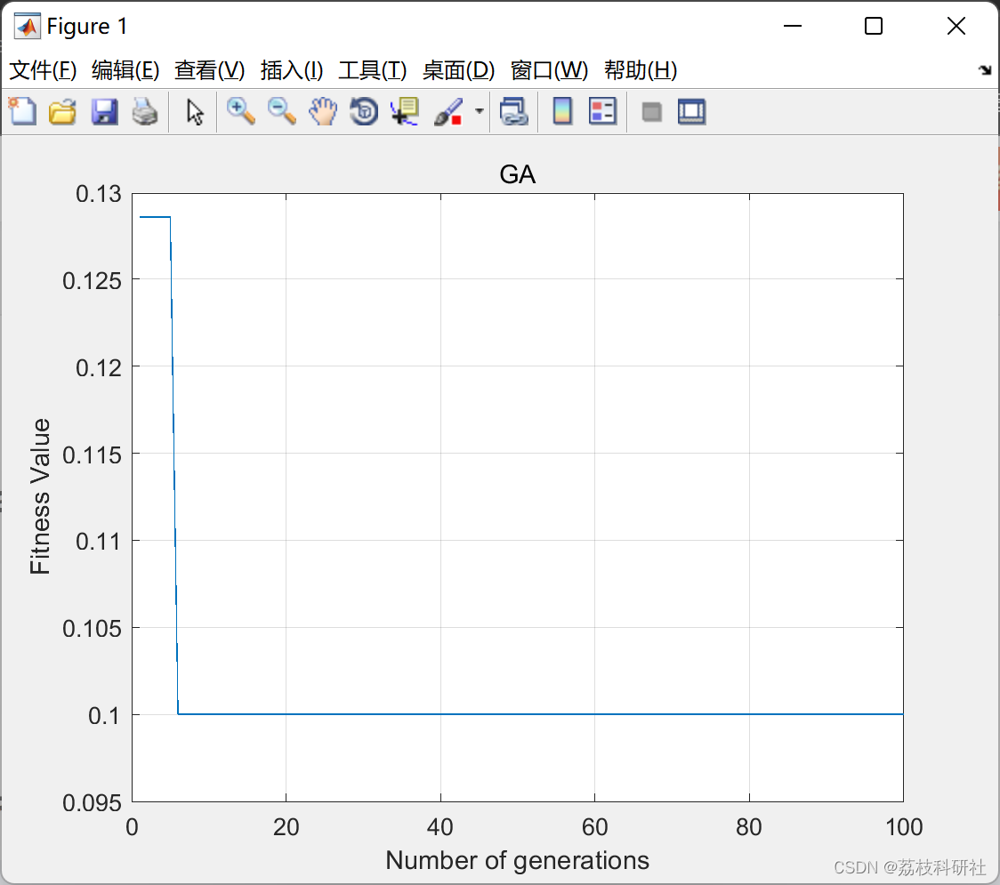

# Genetic Algorithm Based on Feature Selection (Matlab Code Implementation)

​  
References:
Editor
With the continuous advancement of computer technology and the in-depth study and application of big data, various industries across society are moving towards mechanization with finer details. This trend necessitates more advanced artificial intelligence methods to replace the previous tedious and detailed manual labor. Due to the increasingly complex problem constraints and higher data dimensions, there is a demand for faster and more accurate big data processing technologies. Machine learning is currently the main technology used for handling big data, and its effectiveness largely relies on feature engineering of datasets. Feature engineering mainly includes feature extraction and selection, which this work primarily focuses on. Facing data with a feature dimension of N that requires O(2N) complexity for feature selection, intelligent algorithms can be implemented as a feasible solution. This work chooses genetic algorithms to implement intelligent feature selection. Genetic algorithms, with their own advantages, have been widely applied in many fields, but they still suffer from premature convergence and slow computational speed when dealing with large amounts of data. To handle feature selection issues, genetic algorithms must rely on the dataset to determine the fitness function, and each call to the fitness function is the most time-consuming. To improve its convergence speed, it is necessary to improve the genetic algorithm. 📚2 Run Results​Edit
Part of the code:
%-------------------------------------------------------------------%  
% Genetic Algorithm (GA) demo version               %  
%-------------------------------------------------------------------%  
%---Input------------------------------------------------------------  
% feat  : feature vector (instances x features)  
% label  : label vector (instance x 1)  
% N    : Number of chromosomes  
% max_Iter : Maximum number of generations  
% CR   : Crossover rate  
% MR   : Mutation rates  
%---Output-----------------------------------------------------------  
% sFeat  : Selected features (instances x features)  
% Sf   : Selected feature index  
% Nf   : Number of selected features  
% curve  : Convergence curve  
%--------------------------------------------------------------------  
%% Genetic Algorithm (version 1)  
clc, clear, close  
% Benchmark data set  
load ionosphere.mat;  
% Set 20% data as validation set  
ho = 0.2;  
% Hold-out method  
HO = cvpartition(label,'HoldOut',ho,'Stratify',false);  
% Parameter setting  
N    = 10;  
max_Iter = 100;  
CR   = 0.8;  
MR   = 0.3;  
% Genetic Algorithm  
[sFeat,Sf,Nf,curve] = jGA1(feat,label,N,max_Iter,CR,MR,HO);  
% Plot convergence curve  
plot(1:max_Iter,curve);  
xlabel('Number of generations');  
ylabel('Fitness Value');  
title('GA'); grid on;  
%% Genetic Algorithm (version 2)  
clc, clear, close  
% Benchmark data set  
load ionosphere.mat;  
% Set 20% data as validation set  
ho = 0.2;  
% Hold-out method  
HO = cvpartition(label,'HoldOut',ho,'Stratify',false);  
% Parameter setting  
N    = 10;  
max_Iter = 100;  
CR   = 0.6;  
MR   = 0.001;  
% Genetic Algorithm  
[sFeat,Sf,Nf,curve] = jGA2(feat,label,N,max_Iter,CR,MR,HO);  
% Plot convergence curve  
plot(1:max_Iter,curve);  
xlabel('Number of generations');  
ylabel('Fitness Value');  
title('GA'); grid on;  
🌈3 Matlab code implementation
🎉4 References
[2]Too, Jingwei, et al. "EMG Feature Selection and Classification Using a Pbest-Guide Binary Particle Swarm Optimization." Computation, vol. 7, no. 1, MDPI AG, Feb. 2019, p. 12, doi:10.3390/computation7010012.  
​  

## Images

<!-- PAYMENT_BLOCK -->

## Get this dataset

- Payment link (Stripe): [Buy now](https://buy.stripe.com/3cs8yP7sY87d0vu9AB)
- Payment QR code: 

<!-- /PAYMENT_BLOCK -->
